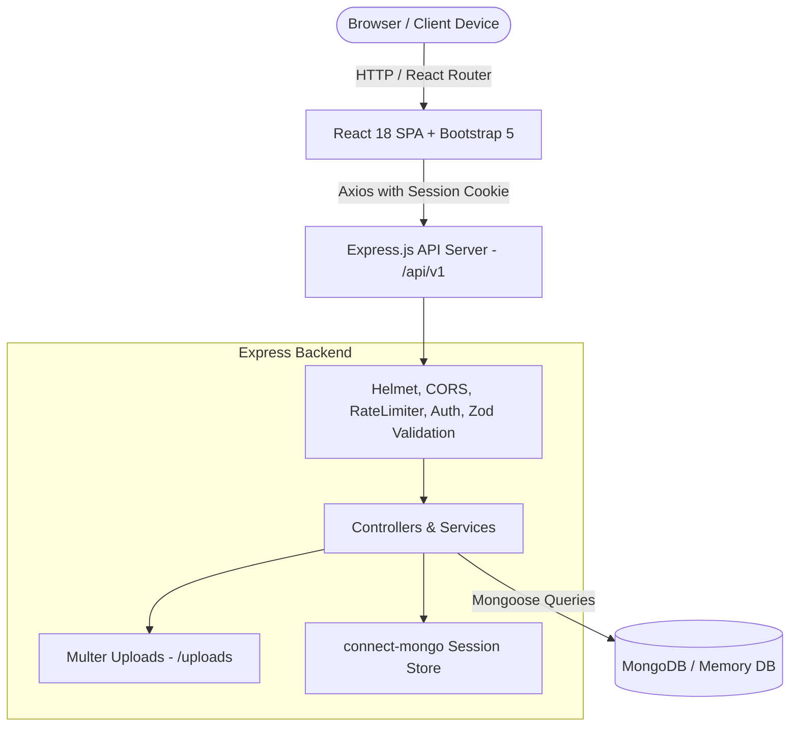

# Warehouse Management System (WMS)
> A full-stack, responsive, and secure Warehouse Management System for tracking inventory, categories, suppliers, customers, stock movements, and customer orders.
> Built for College-Level Web Development Mini-Project Submission.

[](https://nodejs.org/)
[](https://react.dev/)
[](https://expressjs.com/)
[](https://mongoosejs.com/)
[](https://getbootstrap.com/)

---

## 1. Project Overview & Abstract

The **Warehouse Management System (WMS)** is an enterprise-grade web application designed to optimize warehouse storage logistics, prevent stockouts, maintain referential audit integrity, and streamline the customer order fulfillment lifecycle.

The system demonstrates practical implementation of full-stack web development:
- **Client-Side Programming**: React 18, React Router SPA navigation, Bootstrap 5 UI, Recharts analytics, React Hook Form, and Zod client validation.
- **Server-Side Programming**: Node.js, Express.js REST API with versioning (`/api/v1`), Zod validation middleware, Multer image uploads, and centralized error handling.
- **Database Engineering**: MongoDB with Mongoose schemas, unique indexes, referential integrity guards, and snapshot preservation on order line items.
- **Security & Session Management**: `express-session` with `connect-mongo`, HTTP-Only session cookies, bcrypt password hashing, role-based access control (RBAC), and authentication rate limiting.

---

## 2. Technology Stack

### Frontend
- **Framework**: React.js with Vite
- **Routing**: React Router DOM (v6) with protected and public route wrappers
- **Styling**: Bootstrap 5.3 & Bootstrap Icons
- **HTTP Client**: Axios with `withCredentials: true` and interceptors
- **Form Management**: React Hook Form with `@hookform/resolvers/zod`
- **Validation**: Zod schema validation
- **Data Visualizations**: Recharts (Monthly Order Activity & Category Stock Distribution)

### Backend
- **Runtime & Framework**: Node.js & Express.js
- **Database**: MongoDB with Mongoose ORM
- **Session Store**: `express-session` + `connect-mongo` (persistent session storage)
- **Password Security**: `bcryptjs` (salted hashing)
- **Validation**: Zod request schema validation middleware
- **File Uploads**: Multer (file type restriction, size limiting to 2MB, safe filename hashing)
- **Security Headers**: Helmet & CORS with origin verification
- **Rate Limiting**: `express-rate-limit` for authentication protection
- **Turnkey DB Fallback**: `mongodb-memory-server` (allows instant execution on any evaluator machine without installing MongoDB)

---

## 3. Pre-Seeded Demonstration Accounts

The system includes a secure database seed script (`npm run seed`) that populates initial warehouse products, suppliers, categories, customers, and pre-configured accounts:

| Role | Email Address | Password | Permissions & Access Scope |
|:---|:---|:---|:---|
| **System Administrator** | `admin@warehouse.local` | `Admin@12345` | Complete unrestricted access across all modules, user accounts, and deletions. |
| **Warehouse Manager** | `manager@warehouse.local` | `Manager@12345` | Manage catalog items, categories, suppliers, customers, inventory intake, and orders. |
| **Warehouse Staff** | `staff@warehouse.local` | `Staff@12345` | View inventory levels, record stock movements, and create customer orders. |

*Quick Demo Feature: The login page includes one-click demo login buttons for instant evaluation.*

---

## 4. System Architecture



---

## 5. Quick Start & Setup Instructions

### Prerequisites
- Node.js (v18 or higher recommended)
- Git

### Step 1: Install Dependencies
Open a terminal in the root project folder:

```bash
# 1. Install server dependencies
cd server
npm install

# 2. Install client dependencies
cd ../client
npm install
```

### Step 2: Seed the Database
Run the seed script in the `server` directory to populate initial accounts and sample warehouse inventory:

```bash
cd server
npm run seed
```

### Step 3: Run the Application

#### Option A: Running the Production Build (Turnkey Single-Port Server)
The client has already been built into `client/dist`. Starting the Express server serves both the REST API and the React SPA on port 5000 with clean URL rewriting:

```bash
cd server
npm start
```
Open **`http://localhost:5000`** in your browser.

#### Option B: Running Development Mode (Dual Server with Hot Reload)
In Terminal 1 (Backend):
```bash
cd server
npm run dev
```

In Terminal 2 (Frontend):
```bash
cd client
npm run dev
```
Open **`http://localhost:5173`** in your browser.

---

## 6. Automated Testing Suite

To execute the backend automated integration test suite covering all 26 test cases:

```bash
cd server
npm run test:api
```

This verifies:
1. Server health and security headers
2. Registration restrictions (public self-registration of Admin role blocked)
3. Session cookies and logout destruction
4. Product, category, supplier, customer CRUD operations
5. Stock movement calculation and negative stock prevention
6. Order placement stock deduction and cancellation restoration
7. Real-time dashboard analytics calculation
8. Authorized CSV data exports

---

## 7. Live Demonstration / Viva Workflow

1. **Sign In**:
   - Navigate to `/login`. Use the one-click **"Admin"** button (or enter `admin@warehouse.local` / `Admin@12345`).
2. **Review Dashboard**:
   - Inspect total products, suppliers, customers, inventory units, low stock alerts, and recent movements. Notice the interactive Recharts charts.
3. **Product Management**:
   - Navigate to **Products**. Filter by Category or select "Low Stock" from the stock status dropdown.
   - Click **Add New Product**. Upload a product image, assign a location (e.g. `Bay B-04`), set prices and initial stock. Save and verify it appears in the table.
4. **Inventory & Stock Movements**:
   - Navigate to **Stock Movements**.
   - Click **Record Stock Movement**. Select an item, select `OUT`, and attempt to deduct more units than available to demonstrate negative stock prevention.
   - Record a valid `IN` movement and confirm the product quantity increases immediately.
5. **Customer Orders & Inventory Workflow**:
   - Navigate to **Orders** &rarr; **Create New Order**.
   - Select customer `Metro Distribution Hub`. Add products and observe automatic price calculation.
   - Submit order. Notice stock units for selected items are deducted immediately.
   - Open the created order invoice. Click **Update Status** &rarr; **Cancelled**.
   - Verify that all deducted stock is automatically restored back to inventory and logged in the movements audit trail.
6. **Reports & CSV Export**:
   - Navigate to **Reports**. Review the Current Inventory and Low Stock tabs.
   - Click **Export Inventory CSV** to download the authorized backend report.
7. **Role-Based Authorization & Logout**:
   - Logout from Admin and login as `staff@warehouse.local`.
   - Observe that administrative deletion buttons and configuration options are restricted.
   - Test password change and profile updates in **User Profile**.

---

## 8. Project Folder Structure

```
warehouse-management-system/
  client/
    public/
    src/
      assets/
      components/
        common/          # StatCard, Pagination, StatusBadge, ConfirmModal, etc.
        layout/          # Navbar, Sidebar, Footer
      context/           # AuthContext, ToastContext
      layouts/           # AppLayout
      pages/             # 17 application pages
      routes/            # AppRoutes, ProtectedRoute, PublicRoute
      services/          # Axios API services
      App.jsx
      main.jsx
      index.css
    package.json
    vite.config.js
  server/
    config/              # db.js, session.js
    controllers/         # auth, product, category, supplier, customer, etc.
    middleware/          # auth, upload, validate, errorHandler, rateLimiter
    models/              # User, Product, Category, Supplier, Customer, Order, etc.
    routes/              # /api/v1 versioned Express route modules
    scripts/             # seed.js, test-api.js
    uploads/             # Multer asset uploads
    utils/               # validators.js
    app.js
    server.js
    package.json
    .env.example
  docs/
    er-diagram.md        # Mermaid ER diagram & relational mapping
    api-documentation.md # Complete REST API reference
    testing-report.md    # 26 automated & manual test cases
  README.md
  .gitignore
```

---

## 9. Academic & Submission Notes

- **URL Rewriting & SPA Routing**: Demonstrates HTML5 History API URL rewriting handled both client-side via React Router and server-side via Express SPA catch-all middleware.
- **Session Security**: Session cookies utilize `httpOnly: true` and `sameSite: 'lax'` to prevent cross-site scripting (XSS) credential theft. Passwords and session IDs are never exposed to `localStorage`.
- **Referential Integrity**: Implements cascading and dependency checks to prevent orphaned order or product records.
# WareHouse-Management

