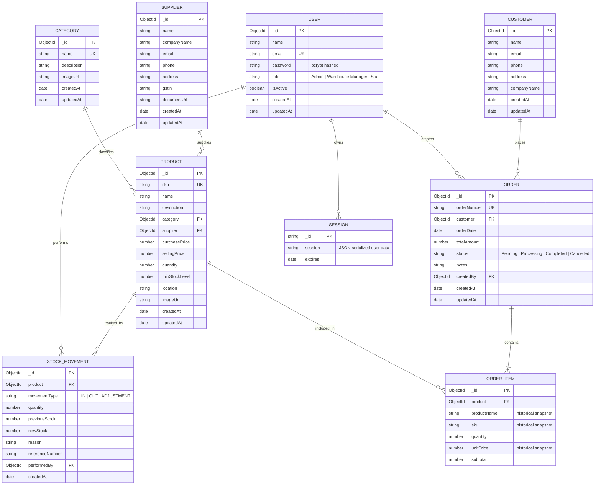

# Database Design & Entity-Relationship (ER) Diagram
## Warehouse Management System (WMS)

This document describes the schema design, collection specifications, indexes, and entity relationships for the Warehouse Management System built on MongoDB and Mongoose.

---

## 1. Mermaid Entity-Relationship Diagram

---

## 2. Collection Descriptions & Schema Architecture

### 2.1 Users Collection (`users`)
- **Purpose**: Stores authorized system users across three roles: `Admin`, `Warehouse Manager`, and `Staff`.
- **Key Fields**:
  - `name`: Full name of employee.
  - `email`: Unique login identifier. Indexed with a unique index.
  - `password`: Salted and hashed password using `bcryptjs` (pre-save hook). Never returned in API responses.
  - `role`: Role-based access control selector (`Admin`, `Warehouse Manager`, `Staff`).
  - `isActive`: Account status flag.

### 2.2 Categories Collection (`categories`)
- **Purpose**: Organizes warehouse inventory into operational groups.
- **Key Fields**:
  - `name`: Category name (e.g., Electronics, Safety, Machinery). Unique index enforced.
  - `description`: Scope of category.
- **Referential Integrity**: Deletion is prohibited if active products reference this category (`Product.countDocuments({ category: id }) > 0`).

### 2.3 Suppliers Collection (`suppliers`)
- **Purpose**: Tracks authorized manufacturers and wholesale vendors supplying warehouse goods.
- **Key Fields**:
  - `companyName`: Business identity.
  - `name`: Point of contact.
  - `email`, `phone`, `address`: Contact vectors.
  - `gstin`: Optional tax registration number.
- **Referential Integrity**: Deletion is blocked if active inventory products depend on this supplier.

### 2.4 Products Collection (`products`)
- **Purpose**: Core inventory master record.
- **Key Fields**:
  - `sku`: Stock Keeping Unit (e.g., `WMS-SCN-001`). Unique, uppercase index.
  - `name`: Catalog description.
  - `category`: Reference ObjectId to `categories`.
  - `supplier`: Reference ObjectId to `suppliers`.
  - `purchasePrice`: Cost basis for warehouse inventory valuation.
  - `sellingPrice`: Base customer retail / wholesale pricing.
  - `quantity`: Current physical units on hand (cannot be negative).
  - `minStockLevel`: Threshold for low-stock triggers.
  - `location`: Specific warehouse aisle, rack, or bin coordinates (e.g., `Aisle 2 - Shelf B`).
  - `imageUrl`: Public path to uploaded product asset (`/uploads/...`).

### 2.5 Customers Collection (`customers`)
- **Purpose**: Represents purchasing corporate clients or retail buyers.
- **Key Fields**:
  - `name`, `companyName`, `email`, `phone`, `address`.
- **Relationships**: One customer has many orders.

### 2.6 Stock Movements Collection (`stockmovements`)
- **Purpose**: Immutable append-only audit trail recording every change to inventory quantities.
- **Key Fields**:
  - `product`: Reference ObjectId to `products`.
  - `movementType`: `IN` (restock/intake), `OUT` (dispatch/order shipment), `ADJUSTMENT` (audit count reconciliation).
  - `quantity`: Count of items changed.
  - `previousStock`: Quantity before operation.
  - `newStock`: Quantity after operation.
  - `reason`: Justification text for audit log.
  - `referenceNumber`: PO number, Order number, or Audit tag.
  - `performedBy`: Reference ObjectId to `users`.

### 2.7 Orders Collection (`orders`)
- **Purpose**: Tracks customer orders, fulfillment stages, and billing totals.
- **Key Fields**:
  - `orderNumber`: Unique alphanumeric identifier (`ORD-YYYYMMDD-XXXX`).
  - `customer`: Reference ObjectId to `customers`.
  - `items`: Embedded array of `OrderItem` subdocuments.
    - Captures historical snapshots of `productName`, `sku`, and `unitPrice` so past orders remain financially accurate even if catalog records change in the future.
  - `totalAmount`: Sum of subtotal values.
  - `status`: `Pending`, `Processing`, `Completed`, `Cancelled`.
  - `createdBy`: Reference ObjectId to `users`.

### 2.8 Sessions Collection (`sessions`)
- **Purpose**: Managed by `connect-mongo` for persistent server-side session management. Stores authenticated user ID and cookie session IDs with automatic TTL expiration (24 hours).
